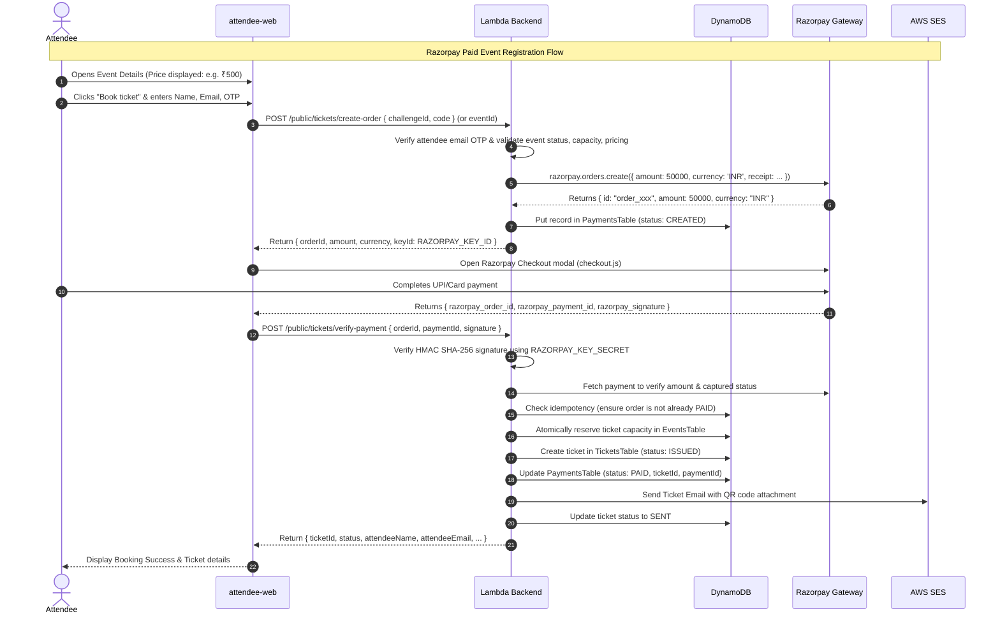
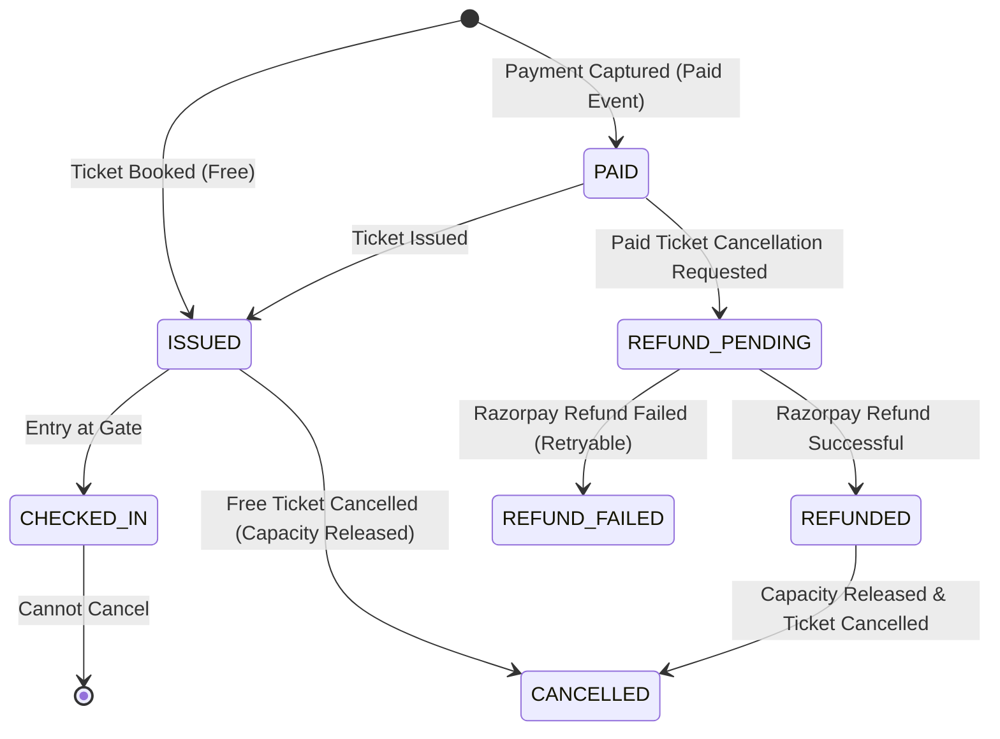

# IMPLEMENTATION PLAN: Razorpay Payments & Admin Analytics Integration

## 1. Executive Summary & Existing System Analysis

### 1.1 Project Structure
The repository is an event ticketing and QR validation system organized as follows:
- **`backend/`**: Serverless backend using AWS SAM (`template.yaml`), Node.js (v20.x, CommonJS).
  - `src/functions/`: AWS Lambda handlers for authentication, event management, ticket issuance, gate check-in, and attendee email OTP verification.
  - `src/lib/`: Modular libraries for DynamoDB (`db.js`), JWT signing/verification (`jwt.js`), admin auth (`auth.js`), OTP management (`otp.js`), email dispatch via SES/nodemailer (`email.js`), QR generation (`qrcode.js`), Secrets Manager access (`secrets.js`), and HTTP/CORS helpers (`http.js`).
  - `tests/`: Automated test suites (`test_backend.js`, `test_handlers_e2e.js`, `test_otp_e2e.js`) using in-memory DynamoDB and service mocks.
- **`frontend/admin-web/`**: Vite + React 18 single-page application for administrators.
  - Features: Admin sign-in, event list, event detail with stats and tickets table, ticket cancellation, ticket resend, and create event modal.
  - Styling: Pure Vanilla CSS with a modern corporate palette (`#14213d` navy, `#ef8354` coral, `#f4f7fb` background).
- **`frontend/attendee-web/`**: Vite + React 18 single-page application for event attendees.
  - Features: Public event browsing (`/` or `#events`), ticket booking with email OTP challenge (`Booking` modal), digital ticket view with QR (`TicketCard`), and ticket lookup/self-cancellation (`/ticket/manage`).
- **`frontend/gate-app/`**: Flutter mobile application for gate security staff scanning ticket QR codes and verifying single-use check-in against `POST /verify`.

---

### 1.2 Existing Database Schema (DynamoDB)
1. **`AdminsTable`**:
   - Hash Key: `adminId` (String UUID)
   - GSI: `EmailIndex` (`email`)
   - Attributes: `adminId`, `email`, `password` (bcrypt hash), `name`, `createdAt`.
2. **`EventsTable`**:
   - Hash Key: `eventId` (String UUID)
   - GSI: `AdminIndex` (`adminId`)
   - Attributes: `eventId`, `adminId`, `name`, `venue`, `date`, `capacity` (nullable number), `ticketsIssued` (number), `status` (`ACTIVE`), `createdAt`.
   - *Current State*: **No pricing attributes exist.** All events are treated as free, open or capacity-limited registrations.
3. **`TicketsTable`**:
   - Hash Key: `ticketId` (String UUID)
   - GSI: `EventIndex` (Hash: `eventId`, Range: `ticketId`)
   - Attributes: `ticketId`, `eventId`, `attendeeName`, `attendeeEmail`, `status` (`ISSUED`, `SENT`, `CHECKED_IN`, `CANCELLED`), `qrToken` (JWT), `issuedAt`, `checkedInAt`, `checkedInBy`.
   - *Current State*: **No payment or refund records exist.**
4. **`VerificationCodesTable`**:
   - Hash Key: `challengeId` (String UUID)
   - GSI: `TicketIdIndex` (`ticketId`)
   - TTL: `expiresAt` (epoch seconds, 10 min window)
   - Attributes: `challengeId`, `purpose` (`BOOKING`, `CANCELLATION`), `eventId`, `ticketId`, `attendeeEmail`, `codeHash` (HMAC-SHA256), `attempts`, `used`, `createdAt`.

---

### 1.3 Current Event Registration & Cancellation Flow
```mermaid
sequenceDiagram
    autonumber
    actor Attendee
    participant Frontend as attendee-web
    participant API as Lambda Backend
    participant DB as DynamoDB
    participant Email as AWS SES

    Note over Attendee,Email: Current Free Registration Workflow
    Attendee->>Frontend: Click "Book ticket" on event card
    Attendee->>Frontend: Enter Name & Email, click "Request email OTP"
    Frontend->>API: POST /public/tickets/request-verification
    API->>DB: Check event exists & ACTIVE; create challenge in VerificationCodesTable
    API->>Email: Send 6-digit OTP to attendee email
    API-->>Frontend: Return { challengeId }
    Attendee->>Frontend: Enter 6-digit OTP, click "Complete booking"
    Frontend->>API: POST /public/tickets/verify-and-book { challengeId, code }
    API->>DB: Atomically mark challenge used (conditional update)
    API->>DB: Atomically reserve capacity (ticketsIssued < capacity) in EventsTable
    API->>DB: Put ticket in TicketsTable (status: ISSUED)
    API->>Email: Send ticket email with signed QR code attachment
    API->>DB: Update ticket status to SENT
    API-->>Frontend: Return { ticketId, status, attendeeName, attendeeEmail }
    Frontend-->>Attendee: Display TicketCard with QR
```

#### Current Cancellation Flow:
1. **Attendee Self-Service**: Attendee enters `ticketId` at `/ticket/manage`. Requests cancellation OTP via `POST /public/tickets/{ticketId}/cancel/request-code`. Receives email OTP. Submits OTP via `POST /public/tickets/{ticketId}/cancel/verify-code`. Backend marks ticket `CANCELLED` and atomically decrements `ticketsIssued` in `EventsTable`.
2. **Admin Cancellation**: Authenticated admin clicks "Cancel" on a ticket in `admin-web`. Backend verifies admin owns the event, marks ticket `CANCELLED`, and decrements `ticketsIssued`.
3. *Current Limitation*: Zero payment or refund handling.

---

### 1.4 Existing Bugs, Debt & Security Considerations Found During Inspection
1. **`getTicket.js` vs `test_handlers_e2e.js` Discrepancy**:
   - In `getTicket.js`:
     ```javascript
     const path = event.resource || event.path || '';
     if (path.includes('/admin/tickets/')) { /* requires admin JWT */ }
     ```
   - In `test_handlers_e2e.js` line 248, `getTicketHandler` is invoked without `resource` or `path` in the mock event, causing it to fall through to public attendee view and return HTTP 200 instead of HTTP 401. This causes `test_handlers_e2e.js` to fail.
   - *Fix*: Standardize route recognition in `getTicket.js` (or mock event path) so admin route is strictly enforced.
2. **Backend `.gitignore` Missing `.env`**:
   - `frontend/.gitignore` contains `.env`, but `backend/.gitignore` and workspace root did not contain `.env` or `.env.*`. Any backend `.env` created for Razorpay credentials risks accidental git commits.
   - *Fix*: Add `.gitignore` rules for `.env` and `.env.*` in backend and workspace root immediately.
3. **No Database Representation for Payments**:
   - Neither `EventsTable` nor `TicketsTable` track payments, currencies, orders, or transactions.
4. **Capacity Race Conditions for Paid Orders**:
   - If an attendee initiates payment on the last remaining ticket, completes payment in 2 minutes, but another attendee booked it in between, an overbooking could occur unless capacity is reserved temporarily or validated conditionally before capture/issuance.
5. **No Event Pricing Fields**:
   - Neither frontend nor backend currently support ticket price or currency.

---

## 2. Proposed Architecture & Design

### 2.1 Technology Stack & Tools
- **Payment Gateway**: Razorpay (using official `razorpay` Node.js SDK on backend; Razorpay Standard Checkout `checkout.js` on frontend).
- **Backend**: Node.js 20.x, AWS Lambda, DynamoDB, API Gateway, Crypto (HMAC SHA-256 for signature verification).
- **Frontend**: React 18, Vite, Vanilla CSS adhering to existing design system (navy `#14213d`, slate `#6c7890`, coral `#ef8354`, mint `#137a4c`, crimson `#b42318`).
- **Data Charting / Analytics**: Pure responsive CSS/SVG charts (bar charts, sparklines, progress bars, metric cards) perfectly matching the existing UI aesthetic without adding bloated external dependencies.

---

### 2.2 Database Schema Enhancements (DynamoDB)

#### A. `EventsTable` (Updated attributes)
| Field | Type | Description |
|---|---|---|
| `eventId` | String (UUID) | Partition key |
| `adminId` | String (UUID) | Admin owner (GSI: `AdminIndex`) |
| `name`, `venue`, `date`, `capacity`, `ticketsIssued`, `status`, `createdAt` | ... | Existing attributes |
| `isPaid` | Boolean | `true` if paid event, `false` or absent for free event (default `false`) |
| `price` | Number | Ticket price in **integer paise** (e.g. ₹499 = `49900`). `0` for free events |
| `currency` | String | Default `'INR'` |
| `salesStart` | String (ISO 8601) | Optional: Sales start date/time |
| `salesEnd` | String (ISO 8601) | Optional: Sales end date/time |
| `maxTicketsPerUser` | Number | Optional per-user ticket limit (default `1`) |

#### B. `TicketsTable` (Updated attributes)
| Field | Type | Description |
|---|---|---|
| `ticketId` | String (UUID) | Partition key |
| `eventId` | String (UUID) | GSI: `EventIndex` |
| `attendeeName`, `attendeeEmail`, `status`, `qrToken`, `issuedAt`, `checkedInAt`, `checkedInBy` | ... | Existing attributes |
| `orderId` | String | Razorpay Order ID (`order_xxx`) or `'FREE_xxx'` |
| `paymentId` | String | Razorpay Payment ID (`pay_xxx`) or `null` |
| `pricePaid` | Number | Amount paid in paise (`0` for free) |
| `currency` | String | Default `'INR'` |
| `refundStatus` | String | `'NONE'`, `'PENDING'`, `'REFUNDED'`, `'FAILED'` |
| `refundAmount` | Number | Amount refunded in paise |
| `refundId` | String | Razorpay Refund ID (`rfnd_xxx`) |

#### C. New Table: `PaymentsTable` (or `OrdersTable`)
Dedicated table for full transaction auditability, analytics aggregation, and webhook reconciliation:
- **Table Name**: `PaymentsTable` (referenced via environment variable `PAYMENTS_TABLE`)
- **Primary Key**: `orderId` (String, HASH) — Razorpay order ID or generated order reference
- **Global Secondary Indexes**:
  1. `EventIndex`: HASH `eventId`, RANGE `createdAt` (for event-specific analytics & transaction lists)
  2. `AdminIndex`: HASH `adminId`, RANGE `createdAt` (for administrator-wide analytics & revenue aggregation)
  3. `PaymentIdIndex`: HASH `paymentId` (for fast webhook lookups)
- **Attributes**:
  - `orderId`: String (`order_xxx`)
  - `paymentId`: String (`pay_xxx`, nullable until payment)
  - `eventId`: String
  - `adminId`: String
  - `attendeeName`: String
  - `attendeeEmail`: String
  - `amount`: Number (in paise)
  - `currency`: String (`'INR'`)
  - `status`: String (`'CREATED'`, `'PENDING'`, `'PAID'`, `'FAILED'`, `'CANCELLED'`, `'REFUNDED'`)
  - `ticketId`: String (nullable until confirmed)
  - `paymentMethod`: String (e.g. `'card'`, `'upi'`, `'netbanking'`, captured from Razorpay response)
  - `refundId`: String (nullable)
  - `refundAmount`: Number (in paise, default 0)
  - `refundStatus`: String (`'NONE'`, `'PENDING'`, `'REFUNDED'`, `'FAILED'`)
  - `refundReason`: String
  - `errorDescription`: String (if payment failed)
  - `createdAt`: String (ISO 8601)
  - `updatedAt`: String (ISO 8601)

---

### 2.3 Razorpay Payment Integration Architecture



#### Webhook Backup & Reconciliation:
- Route: `POST /webhooks/razorpay`
- Computes HMAC SHA256 of `rawBody` with `RAZORPAY_WEBHOOK_SECRET`.
- Matches header `x-razorpay-signature`.
- Handles `payment.captured` / `order.paid`: If attendee closed the browser before callback completed, webhook idempotently completes ticket generation and marks order `PAID`.
- Handles `payment.failed`: Updates order to `FAILED` with error reason.
- Handles `refund.processed`: Reconciles refund status in `TicketsTable` and `PaymentsTable`.

---

### 2.4 Cancellation & Refund Lifecycle



#### Cancellation Business Rules:
1. **Free Events**: Attendee or Admin cancels → Ticket status becomes `CANCELLED`, capacity is released (`ticketsIssued` decremented). No refund processing needed.
2. **Paid Events - Attendee Self-Service Cancellation**:
   - Attendee verifies OTP at `/ticket/manage`.
   - Eligibility check: Event must be in future (e.g. > 24 hours prior to event date, configurable default).
   - If eligible, backend calls `razorpay.payments.refund(paymentId, { amount, notes })`.
   - On refund success: Ticket status set to `CANCELLED`, refund status set to `REFUNDED`, capacity released, confirmation email sent.
   - If event is within 24 hours: Attendee is notified that cancellations within 24h are non-refundable per policy, or allowed to cancel without refund upon explicit confirmation.
3. **Paid Events - Admin Cancellation**:
   - Administrator can cancel any ticket on their owned event.
   - Admin modal provides options: "Cancel with Full Refund", "Cancel with Partial Refund", or "Cancel without Refund" (with reason).
   - Backend processes refund via Razorpay, updates `PaymentsTable` and `TicketsTable`, releases event capacity.

---

### 2.5 Admin Analytics Calculations & Data Sources

All analytics are scoped to events owned by the authenticated administrator (`adminId`), queried from DynamoDB indexes, and computed server-side:

| Metric | Exact Definition & Formula | Data Source |
|---|---|---|
| **Total Units Sold** | Count of all confirmed paid tickets + confirmed free registrations | `TicketsTable` where `status IN ('ISSUED', 'SENT', 'CHECKED_IN')` |
| **Gross Sales** | Sum of all successfully captured payments (`∑ amount`) in INR before any refunds | `PaymentsTable` where `status = 'PAID'` (in date range) |
| **Total Refunds** | Sum of all confirmed refunds (`∑ refundAmount`) in INR | `PaymentsTable` where `refundStatus = 'REFUNDED'` |
| **Net Ticket Revenue** | `Gross Sales - Total Refunds` (clearly labelled: excludes taxes/payment gateway fees) | Derived |
| **Total Registrations** | All registration attempts (active + cancelled) | `TicketsTable` count for event cohort |
| **Confirmed Registrations** | Current active valid attendees (`ISSUED`, `SENT`, `CHECKED_IN`) | `TicketsTable` active status count |
| **Cancelled Registrations** | Registrations with `status = 'CANCELLED'` | `TicketsTable` cancelled count |
| **Failed Payments** | Payment attempts with `status = 'FAILED'` | `PaymentsTable` where `status = 'FAILED'` |
| **Average Order Value (AOV)** | `Gross Sales ÷ Count of Successful Paid Orders` | Derived (0 if no paid orders) |
| **Cancellation Rate** | `(Cancelled Registrations ÷ Total Registrations) × 100%` | Derived (0% if total is 0) |
| **Refund Rate** | `(Total Refunds ÷ Gross Sales) × 100%` | Derived (0% if gross sales is 0) |
| **Capacity Utilization** | `(Active Valid Tickets ÷ Capacity) × 100%` | For events with capacity set |

#### Analytics API Endpoints:
1. `GET /admin/analytics`:
   - Query parameters: `range` (`today`, `7d`, `30d`, `90d`, `custom`), `startDate`, `endDate`, `eventId`.
   - Returns overview KPIs, revenue time-series data, event comparison metrics, payment method breakdown, registration trends.
2. `GET /admin/events/{eventId}/analytics`:
   - Detailed event-specific analytics: ticket tier breakdown, check-in rate, revenue, refund breakdown, timeline.
3. `GET /admin/payments`:
   - Paginated list of transactions with search (name, email, orderId, paymentId), status filter, and CSV export.
4. `POST /admin/payments/{paymentId}/refund`:
   - Process an administrative refund for a specific booking.

---

## 3. Step-by-Step Implementation Plan

### Phase 1: Environment, SAM Template & Database Foundation
- [ ] Add `.gitignore` rules in backend and workspace root to ensure `.env`, `.env.*` are never committed.
- [ ] Create `.env.example` in `backend/` documenting `RAZORPAY_KEY_ID`, `RAZORPAY_KEY_SECRET`, `RAZORPAY_WEBHOOK_SECRET`.
- [ ] Update `backend/template.yaml` to declare `PaymentsTable` with `AdminIndex`, `EventIndex`, and `PaymentIdIndex`.
- [ ] Add `RAZORPAY_KEY_ID` parameter and wire environment variables to Lambda functions.
- [ ] Install `razorpay` npm package in `backend/` and `backend/src/`.
- [ ] Extend `backend/src/lib/db.js` with payment, order, and refund data access functions.

### Phase 2: Add Event Pricing to Admin Site & Backend
- [ ] Update `backend/src/functions/createEvent.js`:
  - Validate and accept `price` (converted to integer paise), `currency` (default `'INR'`), `isPaid` (boolean), `salesStart`, `salesEnd`, `maxTicketsPerUser`.
  - Validate: Reject negative prices; reject non-zero price when `isPaid` is false.
- [ ] Create `backend/src/functions/updateEvent.js` (`PUT /admin/events/{eventId}`):
  - Allow admin to update event details and pricing safely without altering already-issued ticket prices.
- [ ] Update `frontend/admin-web`:
  - Update `CreateModal` to include Price (₹ INR), Free vs Paid toggle, Sales Start/End dates, and Max Tickets per user.
  - Add Edit Event capability for existing events.
  - Display Price badge (e.g. "Free" or "₹499") in event cards and event detail.

### Phase 3: Razorpay Backend Handlers & Webhook Integration
- [ ] Create `backend/src/lib/razorpay.js`:
  - Initialize Razorpay SDK client with `RAZORPAY_KEY_ID` and `RAZORPAY_KEY_SECRET`.
  - Helper functions for creating orders, fetching payments, verifying signatures, and issuing refunds.
- [ ] Create `backend/src/functions/createPaymentOrder.js` (`POST /public/payments/create-order`):
  - Validates event, availability, pricing, and attendee OTP challenge.
  - Creates Razorpay order and saves record in `PaymentsTable` with status `CREATED`.
  - Returns `{ orderId, amount, currency, keyId }`.
- [ ] Create `backend/src/functions/verifyPaymentAndBook.js` (`POST /public/payments/verify`):
  - Verifies HMAC signature using `crypto.createHmac('sha256', secret)`.
  - Reconciles amount and currency against event price.
  - Reserves capacity and issues ticket atomically.
  - Marks payment `PAID` with `paymentId` and `ticketId`.
  - Dispatches ticket email with QR code.
- [ ] Create `backend/src/functions/razorpayWebhook.js` (`POST /webhooks/razorpay`):
  - Validates webhook signature using raw body.
  - Handles `payment.captured`, `payment.failed`, `refund.processed`.
  - Ensures idempotent handling so retries cause no duplicate tickets or duplicate revenue.

### Phase 4: Attendee Site Razorpay Checkout Integration
- [ ] In `frontend/attendee-web`:
  - Dynamically load Razorpay Checkout script (`https://checkout.razorpay.com/v1/checkout.js`).
  - Update Event cards to display pricing badge ("FREE" or formatted price "₹500").
  - In `Booking` modal:
    - If event is Free: Maintain existing OTP verification and free booking flow.
    - If event is Paid:
      1. Attendee requests OTP verification.
      2. Enters OTP.
      3. Clicks "Proceed to Pay ₹X".
      4. Backend returns Razorpay Order details.
      5. Razorpay Checkout modal opens.
      6. On payment success, sends verification payload to backend.
      7. Displays loading state, handles errors, and displays final `TicketCard` on success.
  - Handle checkout dismissal, retry on failure, and clear error banners.

### Phase 5: Cancellation & Refund Management
- [ ] Update `backend/src/functions/verifyCancellationCode.js` (attendee cancellation) and `cancelTicket.js` (admin cancellation):
  - Check if ticket was paid (`pricePaid > 0` and `paymentId` exists).
  - Check cancellation eligibility and policy (e.g. before event start date).
  - If paid and eligible: Trigger Razorpay refund via API (`razorpay.payments.refund`).
  - Update `TicketsTable` with `refundStatus: 'REFUNDED'`, `refundAmount`.
  - Update `PaymentsTable` with `status: 'CANCELLED'`, `refundStatus: 'REFUNDED'`.
  - Decrement `ticketsIssued` in `EventsTable` (release capacity).
- [ ] Update `/ticket/manage` view in `frontend/attendee-web`:
  - Display purchase details (price paid, payment ID, refund status).
  - Explain refund policy clearly upon cancellation request.

### Phase 6: Comprehensive Admin Analytics Dashboard
- [ ] Create backend analytics handlers:
  - `backend/src/functions/getAdminAnalytics.js` (`GET /admin/analytics`):
    - Aggregates metrics from `EventsTable`, `TicketsTable`, and `PaymentsTable` for the authenticated admin.
    - Supports query parameters: `range=today|7d|30d|90d|all|custom`, `startDate`, `endDate`, `eventId`.
    - Returns KPI metrics, time-series data, event comparison table, cancellation ratios, and payment failure rate.
  - `backend/src/functions/getEventAnalytics.js` (`GET /admin/events/{eventId}/analytics`):
    - Detailed drill-down for a single event.
- [ ] In `frontend/admin-web`:
  - Add top-level navigation: **Events** | **Analytics** | **Transactions**.
  - Build **Analytics Section**:
    - **KPI Cards**: Units Sold, Gross Sales (₹), Total Refunds (₹), Net Ticket Revenue (₹), Total Registrations, Confirmed Registrations, Cancelled Registrations, Failed Payments, AOV (₹), Cancellation Rate (%), Refund Rate (%).
    - **Time Controls**: Filter by Today, Last 7 Days, Last 30 Days, Last 90 Days, Custom Range, and Event dropdown.
    - **Interactive Visualizations (CSS/SVG)**:
      - Revenue over time (daily/weekly bars).
      - Tickets sold over time.
      - Gross vs Net vs Refunds breakdown.
      - Free vs Paid registrations split.
    - **Event-Wise Performance Table**:
      - Event Name, Date, Free/Paid, Price, Total Registrations, Confirmed, Cancelled, Tickets Sold, Capacity Utilization, Gross Sales, Refunds, Net Revenue, Cancellation Rate.
      - Sorting, search, and drill-down into event detail.

### Phase 7: Admin Payment & Booking Management
- [ ] Create `backend/src/functions/listAdminPayments.js` (`GET /admin/payments`):
  - Returns paginated list of payment transactions with attendee details, order ID, payment ID, amount, status, refund status.
- [ ] Create `backend/src/functions/refundPayment.js` (`POST /admin/payments/{paymentId}/refund`):
  - Authorized admin can initiate full or partial refund.
- [ ] In `frontend/admin-web`:
  - Build **Transactions View**:
    - Searchable by attendee name, email, order ID, payment ID, ticket ID.
    - Status filter (`PAID`, `REFUNDED`, `FAILED`, `PENDING`).
    - Refund trigger button for eligible transactions.
    - CSV Export functionality.

### Phase 8: Testing, Verification & Regression Prevention
- [ ] Fix existing test suite bug in `tests/test_handlers_e2e.js` (`getTicket` path recognition).
- [ ] Add unit tests for Razorpay signature verification and order creation.
- [ ] Add integration test suite for:
  - Free event creation and booking (verifying zero regressions).
  - Paid event creation with custom ticket price and capacity.
  - Razorpay order creation and signature verification.
  - Invalid signature rejection.
  - Duplicate payment prevention / idempotency.
  - Capacity exhaustion on paid events.
  - Refund calculation on cancellation.
  - Admin analytics aggregation tests (accurate Gross, Refund, Net, AOV, Rates).
- [ ] Run both Vite production builds (`admin-web` and `attendee-web`) and ensure zero build or lint errors.

---

## 4. Files Expected to be Created or Modified

### New Files
1. `backend/src/lib/razorpay.js` — Razorpay SDK initialization, order creation, signature verification, refund helper.
2. `backend/src/functions/createPaymentOrder.js` — Handler to generate Razorpay order for paid ticket checkout.
3. `backend/src/functions/verifyPaymentAndBook.js` — Handler to verify payment signature and issue ticket.
4. `backend/src/functions/razorpayWebhook.js` — Webhook handler for async payment/refund notifications.
5. `backend/src/functions/getAdminAnalytics.js` — Handler for aggregate admin analytics and time-series metrics.
6. `backend/src/functions/getEventAnalytics.js` — Event-specific analytics drill-down handler.
7. `backend/src/functions/listAdminPayments.js` — Handler to list transactions with search and filters.
8. `backend/src/functions/refundPayment.js` — Handler for admin-initiated refunds.
9. `backend/tests/test_payments_analytics_e2e.js` — Comprehensive E2E test suite for payments, refunds, and analytics.
10. `IMPLEMENTATION_LOG.md` — Detailed loop engineering log tracking inspect, plan, implement, validate, review, fix cycles.

### Modified Files
1. `.gitignore` & `backend/.gitignore` — Add rules to ignore `.env` and `.env.*`.
2. `backend/.env.example` — Document required environment variables.
3. `backend/template.yaml` — Add `PaymentsTable`, API Gateway routes, policies, and parameters.
4. `backend/package.json` & `backend/src/package.json` — Add `razorpay` dependency.
5. `backend/src/lib/db.js` — Add payment table queries, order updates, refund updates, and analytics aggregators.
6. `backend/src/functions/createEvent.js` — Add price, currency, isPaid validation and storage.
7. `backend/src/functions/cancelTicket.js` — Add payment and refund awareness for admin cancellation.
8. `backend/src/functions/verifyCancellationCode.js` — Add payment and refund awareness for attendee cancellation.
9. `backend/src/functions/getTicket.js` — Fix path check and return pricing/payment status.
10. `backend/tests/test_handlers_e2e.js` — Fix mock event path for getTicket and add pricing tests.
11. `frontend/admin-web/src/api/admin.js` — Add analytics, payments, edit event, and refund API methods.
12. `frontend/admin-web/src/main.jsx` — Add Analytics section, Transactions view, Pricing fields in Create Modal.
13. `frontend/admin-web/src/styles.css` — Modern chart, metric card, and table styling.
14. `frontend/attendee-web/src/api/tickets.js` — Add payment order and verification endpoints.
15. `frontend/attendee-web/src/main.jsx` — Integrate Razorpay Checkout, price badges, and payment status screens.
16. `frontend/attendee-web/src/styles.css` — Styles for checkout status, price tags, and payment modal states.

---

## 5. Security & Verification Strategy

1. **Secret Key Isolation**:
   - `RAZORPAY_KEY_SECRET` will ONLY be read server-side via environment variables in Lambda.
   - Frontend bundles and network responses will only receive the public `key_id`.
2. **Signature Verification**:
   - Every payment confirmation requires valid HMAC-SHA256 signature verification matching `crypto.createHmac('sha256', secret).update(order_id + '|' + payment_id).digest('hex')`.
3. **Price Tampering Protection**:
   - The ticket price is ALWAYS read server-side from `EventsTable`. The client is NEVER allowed to submit the price or amount.
4. **Capacity & Concurrency**:
   - Atomic conditional write in DynamoDB ensures ticket capacity cannot be exceeded even if multiple attendees complete payment checkout at the exact same second.
5. **Idempotency**:
   - If an attendee double-submits or a webhook arrives concurrently with the client callback, the system checks the `PaymentsTable` status and ensures a single ticket and single revenue entry are created.
6. **Analytics Integrity**:
   - Metrics are derived strictly from server-side database records. Pending or failed payments are never counted as revenue. Cancelled registrations without refunds do not deduct revenue; refunded payments deduct only the actual refunded amount.
